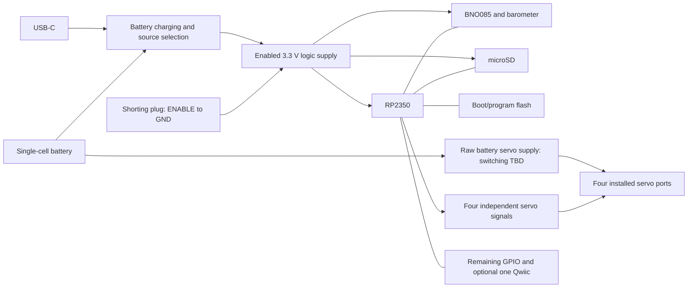

# Preliminary architecture

Status: proposal for reference audit; not an electrically reviewed schematic or a verified layout.

## Functional arrangement

The diagram omits decoupling, protection, crystal/clock circuitry, reset/boot details and individual power pins. Do not use it as a wiring diagram.

## Circuit reuse strategy

- Use Adafruit Feather RP2350 processor, flash, USB and battery circuits as the fallback processor reference.
- Use RP2040 Feather Adalogger microSD circuit and pin requirements as a storage reference, not as a drop-in RP2350 design.
- Inspect the BNO08x sensor circuit and manufacturer reference design. Remove breakout-only level translation/regulation only after confirming every IC supply and strap connection.
- Inspect BMP280 breakout for functional context; choose the new barometer from current manufacturer documentation and supply checks.
- Rename and reconcile nets explicitly. Equal net names in separate source projects do not prove equal function, voltage, or pin assignment.
- Retain upstream license and attribution requirements with all derived work.

## Servo connections

Four standard servo positions can be implemented as a 3 x 4 array at 2.54 mm pitch (or four separate 1 x 3 headers), installed by the assembler. Arrange common power and GND rows and four independent signal pins with clear orientation labels. Confirm actual mating-plug clearance, pin order and installed height during placement.

Assume minimal current. The user confirms nominal-5 V micro servos operate satisfactorily directly from the single-cell battery in the existing gliders. Preserve that supply arrangement; no boost converter is required. Ground remains common with logic. Determine whether a small switch is needed so the tag disables the servos as well as the computer; prevent servo signals from unintentionally powering disabled circuits. Exact part ratings remain a schematic-detail review item.

## Logging and sensing

Provide hardware capable of the existing 50 Hz logging workload, with independent resources for SD, servo outputs and sensors. The user will write Arduino/PlatformIO application firmware separately. Sensor report selection, CSV schema, buffering implementation and application shutdown policy are not part of this hardware effort. A minimal bring-up/test program may check interfaces and recording continuity without becoming the course application.

Baseline is BNO085 with accepted +/-8 g range. A +/-16 g upgrade is an unresolved preference, not authorization for an additional sensor. Route reset/interrupt signals where useful and support recovery from sensor resets. Do not prescribe an interface change until reference and firmware review justify it.

Select a current-production barometer compatible with 3.3 V logic. BMP390 is an initial candidate only, subject to sourcing, layout and driver review. Preserve access to its pressure opening and enclosure venting.

## Mechanical approach

Start with approximately 50.8 x 22.8 mm Feather outline and existing mounting geometry, subject to source-CAD measurement. The user's board has its SD socket on top. Measure underside clearance, mounting-hole keepouts, vias and trace constraints before placing sensors there. Consider either-face sensor placement if it improves assembly cost or routing without compromising package size.

A candidate GPIO allocation is recorded in [pin-allocation.md](pin-allocation.md), based on the pinned references. It preserves the RP2350 Feather's external SPI pins and uses a separate hardware SPI peripheral for microSD. The allocation is provisional until schematic review and the mechanical placement study.
